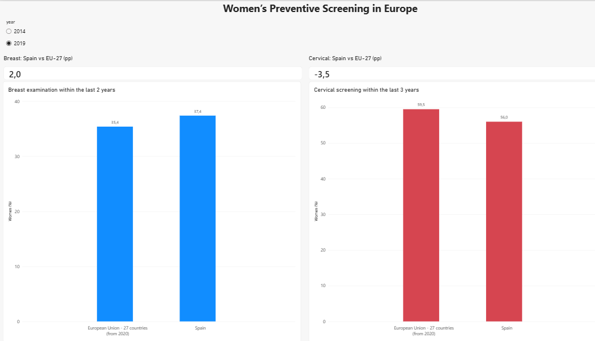

# Профилактические обследования женщин в Европе

Портфолио-проект по анализу данных о прохождении обследований груди и шейки матки в европейских странах с особым вниманием к Испании.



## О проекте

В проекте анализируются данные Европейского опроса о здоровье населения Eurostat за 2014 и 2019 годы.

Основные направления анализа:

- сравнение Испании с агрегированным показателем EU-27;
- различия между возрастными группами;
- различия по уровню образования;
- изменение показателей с 2014 по 2019 год;
- рейтинги стран и образовательные разрывы.

Показатели отражают долю женщин, сообщивших, когда они в последний раз проходили обследование. Эти данные не подтверждают участие в организованной программе скрининга.

## Основные выводы

- В 2019 году 37,4% женщин в Испании сообщили об обследовании груди в течение предыдущих двух лет. Показатель EU-27 составил 35,4%.
- Испания превышала показатель EU-27 по обследованию груди на 2,0 процентного пункта.
- По обследованию шейки матки показатель Испании составлял 56,0%, а EU-27 — 59,5%.
- Испания отставала от EU-27 по обследованию шейки матки на 3,5 процентного пункта.
- Испания занимала 12-е место среди 31 страны по обследованию груди и 20-е место по обследованию шейки матки.
- В Испании обследование груди чаще всего отмечалось среди женщин в возрасте 55–64 лет.
- Самый высокий показатель обследования шейки матки наблюдался среди женщин в возрасте 45–54 лет.
- Различия между уровнями образования были значительно выше для обследования шейки матки, чем для обследования груди.
- С 2014 по 2019 год показатель обследования шейки матки снизился на 2,0 процентного пункта в Испании и на 1,9 процентного пункта в EU-27.

## Использованные инструменты

- Python
- pandas
- matplotlib
- SQL и SQLite
- Power BI
- Git

## Структура проекта

```text
womens-health-screening/
├── data/
│   ├── raw/
│   └── processed/
├── images/
│   └── dashboard_overview.png
├── notebooks/
│   ├── 01_data_exploration.ipynb
│   ├── 02_data_cleaning.ipynb
│   └── 03_analysis.ipynb
├── powerbi/
│   └── screening_dashboard.pbix
├── sql/
│   └── analysis.sql
├── .gitignore
├── README.md
└── requirements.txt
```

## Подготовка данных

Исходные наборы данных Eurostat были исследованы и очищены с помощью Python. Итоговая таблица содержит 20 599 наблюдений и 13 столбцов.

Основные этапы подготовки:

- выбор и переименование необходимых столбцов;
- объединение данных об обследованиях груди и шейки матки;
- удаление наблюдений без значения показателя;
- проверка полных дубликатов и уникальности ключей;
- сохранение флагов качества Eurostat;
- экспорт подготовленных данных в CSV и SQLite.

## Определения показателей

- `Y_LT2` — последнее обследование груди было менее двух лет назад.
- `Y_LT3` — последнее обследование шейки матки было менее трёх лет назад.
- `screening_rate` — доля женщин, сообщивших о прохождении обследования, в процентах.
- `quality_flag` — флаг качества наблюдения Eurostat.

Для обследования груди показатель `Y_LT2` доступен в исходных данных за 2019 год. Значение за 2014 год рассчитывается как сумма `Y_LT1` и `Y1-2`.

## Дашборд

Дашборд Power BI состоит из трёх страниц:

- **Overview** — сравнение Испании с EU-27;
- **Age Groups** — показатели по возрастным группам в Испании;
- **Education** — показатели по уровням образования в Испании.

Срез года позволяет переключаться между 2014 и 2019 годами.

## Как воспроизвести анализ

Установить необходимые библиотеки:

```bash
python -m pip install -r requirements.txt
```

Запустить блокноты по порядку:

1. `01_data_exploration.ipynb`
2. `02_data_cleaning.ipynb`
3. `03_analysis.ipynb`

Запустить SQL-анализ:

```bash
sqlite3 -header -column data/processed/screening.db ".read sql/analysis.sql"
```

База SQLite создаётся блокнотом очистки данных и не хранится в Git.

## Источник данных

Eurostat, European Health Interview Survey:

- самоотчёт о последнем обследовании груди с помощью рентгенографии;
- самоотчёт о последнем обследовании шейки матки.

## Ограничения

- Данные основаны на самоотчётах и могут быть подвержены ошибкам памяти.
- Показатели не подтверждают участие в организованной программе скрининга.
- В проекте используются только два года наблюдений.
- Часть наблюдений содержит флаги качества Eurostat.
- Процентные показатели нельзя интерпретировать как количество женщин.